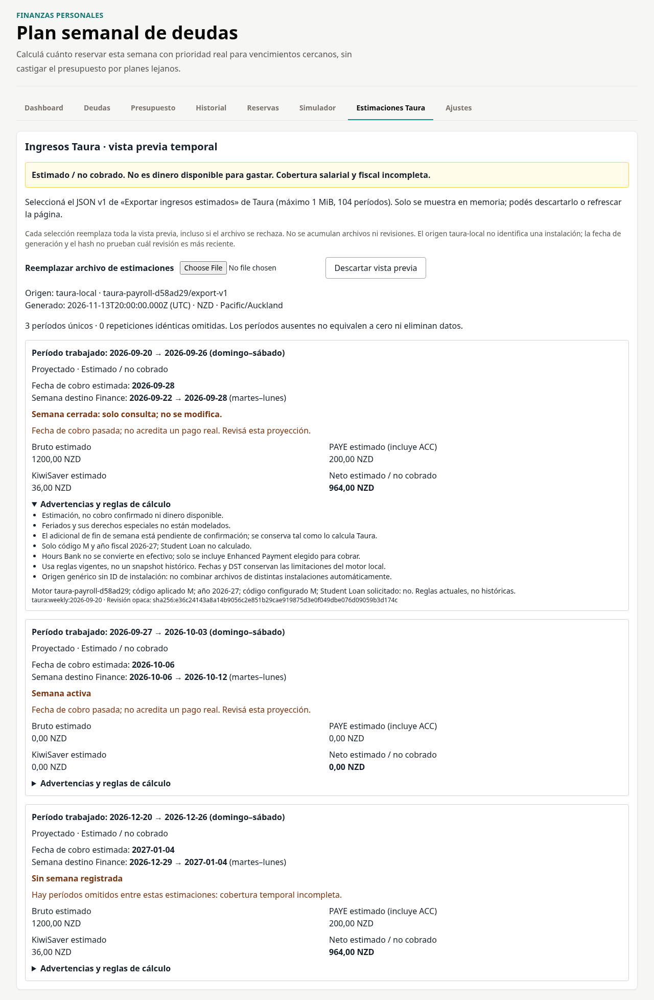
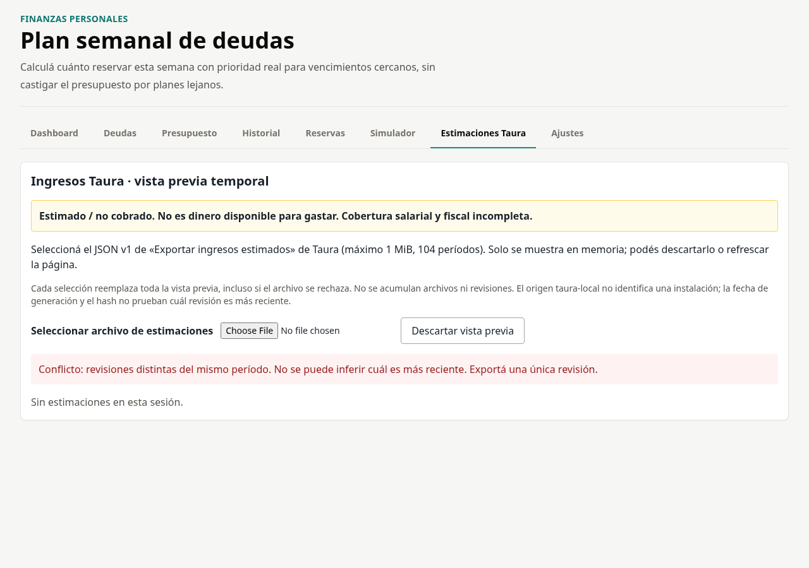
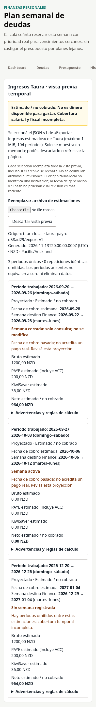

# INT-02B — verificación sintética (14/11/2026)

Resultado: **PASS**, pendiente de revisión integrada. Solo rama de Finance; sin merge.

La historia verificada es: pestaña **Estimaciones Taura** → selección explícita del
JSON v1 → validación local completa → vista temporal → reemplazo/descarte/recarga.
No intervienen API, servidor financiero ni sincronización. El servidor sirve
únicamente los assets del build local.

## Contrato y alcance

Leídos directamente en GitHub: [issue #8 y comentario de dependencia](https://github.com/marcosgaier/taura-roster-pay/issues/8),
[PR Taura #9](https://github.com/marcosgaier/taura-roster-pay/pull/9),
[contrato exacto 5cbceda6](https://github.com/marcosgaier/taura-roster-pay/blob/5cbceda6c7e11afbab4e92102f52ec0f942b3ed6/docs/income-projections-v1.md)
y su `src/services/incomeProjections.ts`.

- Lista permitida exacta de campos, type/schemaVersion, motor/exportador v1,
  NZD/Pacific-Auckland, generación UTC canónica, fechas civiles y período
  domingo–sábado; cobro posterior y dentro de cobertura fiscal M / 2026-27.
- Centavos enteros seguros no negativos, cero explícito válido; PAYE incluye ACC;
  bruto menos PAYE y KiwiSaver debe igualar neto. Reglas, componentes y siete
  advertencias requeridos; hash SHA-256 reconstruido en orden canónico productor.
  El hash comprueba contenido, **no autenticidad ni recencia**.
- Máximo 1 MiB UTF-8 y 104 entradas; rechazo de backups de ambas apps, campos
  extra, ausencia de campos, JSON corrupto y contenido alterado.
- Identidad por período dentro del único lote seleccionado: duplicados idénticos
  colapsados; revisiones diferentes rechazan todo el lote. Seleccionar reemplaza
  toda la sesión (incluso ante error), jamás suma archivos ni ordena hashes.
  No se puede determinar qué revisión es obsoleta; fecha de generación informativa.
- Mapeo **por payDate** a martes–lunes mediante aritmética UTC de fechas civiles,
  independiente de TZ/DST del equipo; se conserva el período trabajado.
- Origen, generación, bruto/PAYE/KiwiSaver/neto, estado laboral, destino, semanas
  cerradas/activas/reabiertas y advertencias visibles. Cobros pasados, generación
  de más de 30 días/futura y huecos entre períodos requieren revisión. La fecha
  antigua es una advertencia informativa, no un orden entre revisiones.
- Todo se etiqueta estimado/no cobrado y no disponible para gastar. No hay
  acción de aplicar, modificar ingresos, presupuesto, reservas o restaurar.
  La sesión vive en useState, permanece al cambiar pestañas y se pierde al
  descartar/recargar. No se cambian schemas de almacenamiento ni backups.

## Fixture y reproducción

[`scripts/fixtures/taura-income-projections-v1.json`](../../scripts/fixtures/taura-income-projections-v1.json)
fue generado ejecutando **el productor real e inalterado** de Taura en 5cbceda6
(transpilado con esbuild), con únicamente entradas sintéticas. Tiene tres
períodos: cobro lunes tras cambio DST, cobro martes con cero explícito y cobro
lunes cruzando el año. Las entradas exactas están en
[`scripts/generate-taura-fixture.mjs`](../../scripts/generate-taura-fixture.mjs).
No usa personas, notas, turnos ni datos persistidos de ninguna aplicación.

Para regenerar opcionalmente el fixture, obtener `src/services/incomeProjections.ts`
del commit indicado en un archivo temporal, y ejecutar:

```sh
node scripts/generate-taura-fixture.mjs /tmp/taura-producer.ts
```

Con dependencias existentes del proyecto y Node 22:

```sh
# En este entorno cloud, seleccionar Node 22 en cada shell:
export PATH=/workspace/.cloud-tools/node_modules/.bin:$PATH
npm test
npm run build
npm run serve
```

En otra terminal (Playwright ya disponible fuera del proyecto en este entorno):

```sh
export PATH=/workspace/.cloud-tools/node_modules/.bin:$PATH
PLAYWRIGHT_MODULE=/workspace/.cloud-tools/node_modules/playwright/index.mjs \
CHROMIUM_PATH=/usr/bin/chromium npm run test:taura-ui
```

En otro equipo se puede usar una instalación externa de Playwright, indicando
su `index.mjs` absoluto y el ejecutable Chromium, o resolver `playwright` normalmente.
No se agregaron dependencias del proyecto. El test solo acepta localhost y
crea un contexto nuevo no persistente; no abre perfiles de usuario. Si el
servidor usa otro puerto, pasar `PREVIEW_URL=http://127.0.0.1:PUERTO`.

Para una prueba manual, abrir Finance con perfil aislado/datos de ejemplo,
entrar a **Estimaciones Taura**, elegir el fixture y revisar fechas, cero,
advertencias y descarte. Para verificar el recorrido con el exportador, usar
el PR #9 de Taura en un perfil separado con **solo datos sintéticos**, ir a
Pagos → Exportar ingresos estimados y elegir ese JSON en Finance. No es
necesario restaurar un backup ni cambiar información financiera para previsualizar.
En esta ejecución el intercambio entre apps se verificó con el archivo generado
por el productor real; no se volvió a ejecutar la UI exportadora de Taura.

## Evidencia ejecutada

Node **v22.23.5**, Chromium **156.0.8078.79**, Playwright externo, zona
Pacific/Auckland, reloj fijo 2026-11-14 NZ. Build de producción servido en localhost.

| Límite del flujo | Resultado / evidencia |
| --- | --- |
| Productor → archivo → consumidor | Fixture del productor real aceptado; hash y contrato completos |
| Archivo → UI | Tres períodos, neto positivo/cero, semanas destino correctas, cerrada/activa |
| UI → advertencias | Cobertura visible, detalles expandibles, períodos omitidos y cobro pasado |
| Conflictos/errores → UI | Duplicados colapsados; conflicto, backups, corrupción, hash y tamaño rechazados; reintento válido |
| Estado temporal | Reemplazo total, descarte (también durante SHA-256), recarga sin sesión |
| UI → finanzas | Texto visible completo del Dashboard igual antes/después |
| UI → almacenamiento | localStorage/sessionStorage iguales, lista de bases IDB igual; cero llamadas mutantes |
| Red/console | Sin solicitudes externas, canales entre pestañas ni errores no capturados |
| Móvil | 390×844, sin desborde horizontal de página; pestañas con scroll propio |

El contexto se carga con Finance sintético antes de medir. Se instrumentan
`Storage.setItem/removeItem/clear`, `IDBObjectStore.put/add/delete/clear`,
`IDBFactory.open/deleteDatabase` y construcción de `BroadcastChannel`.
La preparación del fixture queda fuera de la medición; desde el arranque de
la app y durante todas las acciones se comprueban **cero llamadas** y snapshots
iguales. No hay bases IDB en el perfil sintético. El arranque no necesita escribir
porque el estado sintético ya está presente. No se inspeccionó información real.

- `npm test`: cuatro suites de regresión existentes aprobadas + **12/12** subtests
  nuevos (incluyen revisión, colisión, cero/ausente, DST, mes/año, lunes/martes,
  semanas cerradas/reabiertas e aislamiento).
- `npm run build`: aprobado, 49 módulos. No hay script lint en el repositorio.
- `npm run test:taura-ui`: **8/8** recorridos aprobados.
- `git diff --check`: aprobado.

[Script reproducible](../../scripts/validate-taura-preview.mjs) ·
[Resultado JSON](int-02b-ui-result.json)





## Límites

Validado en Chromium local con tamaños escritorio/móvil; no todos los navegadores,
dispositivos físicos ni ciclo PWA desplegado. SHA-256 necesita HTTPS o localhost.
No se certifican reglas salariales/fiscales: feriados no modelados, adicional de
fin de semana pendiente, Student Loan no calculado y reglas actuales no históricas
siguen siendo limitaciones del contrato. El origen genérico no distingue instalaciones.
No se infiere antigüedad relativa de revisiones ni se reconcilian varios archivos.
Taura y su PR #9 permanecen sin cambios; ningún PR se fusionó.
